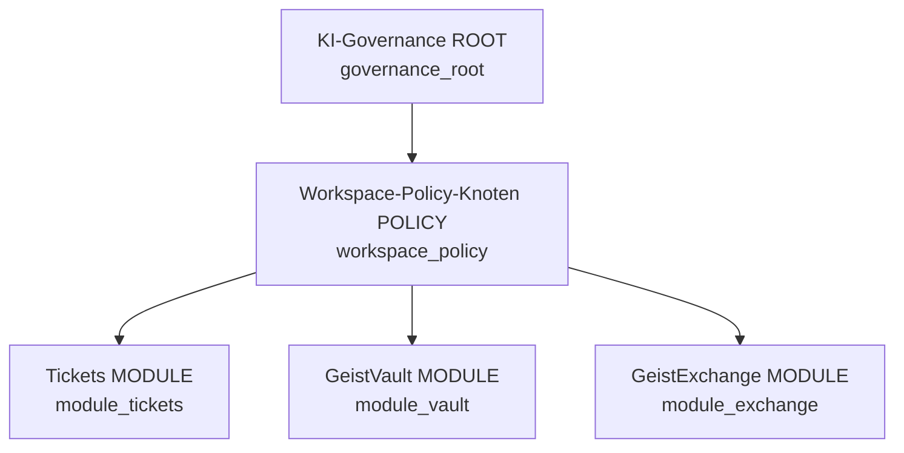
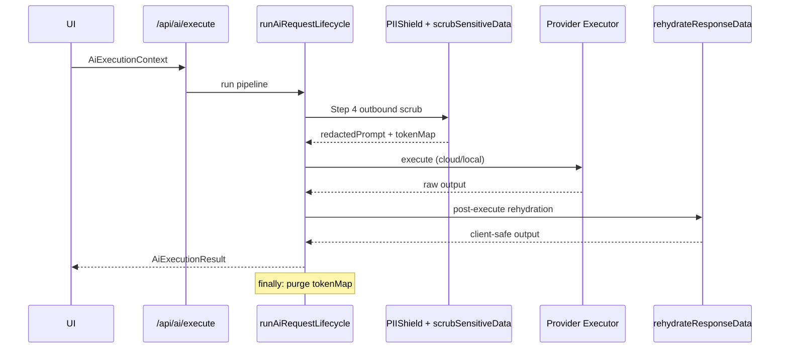
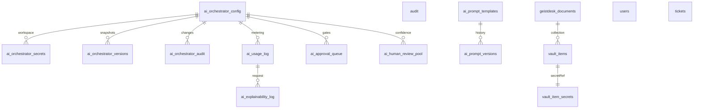

# GeistDesk — Features Manifest

> **Document type:** Master technical feature registry  
> **Repository:** GeistDesk Sovereign AI Orchestrator  
> **Generated from:** Full codebase audit (routes, components, types, stores, middleware, PostgreSQL schema)  
> **UI grounding:** Live screenshot text mappings (DE/EN) cross-referenced against implementation  
> **Last audited:** 2026-07-04  

---

## Table of Contents

1. [Platform Architecture Overview](#1-platform-architecture-overview)
2. [Zone 1 — Central Cockpit & Core System Map](#2-zone-1--central-cockpit--core-system-map)
3. [Zone 2 — Operational Dashboards, Queues & Knowledge](#3-zone-2--operational-dashboards-queues--knowledge)
4. [Zone 3 — Traffic-Routing Workbench & Pipelines](#4-zone-3--traffic-routing-workbench--pipelines)
5. [Zone 4 — Guardrails, Governance & Secure Data Transmission](#5-zone-4--guardrails-governance--secure-data-transmission)
6. [Zone 5 — Providers, Jurisdiction & Auditing](#6-zone-5--providers-jurisdiction--auditing)
7. [Appendix A — Complete Route Registry](#appendix-a--complete-route-registry)
8. [Appendix B — Types, Stores & Services Index](#appendix-b--types-stores--services-index)
9. [Appendix C — PostgreSQL Schema Relations](#appendix-c--postgresql-schema-relations)
10. [Appendix D — Middleware & Auth Hooks](#appendix-d--middleware--auth-hooks)
11. [Appendix E — API Surface](#appendix-e--api-surface)

---

## 1. Platform Architecture Overview

GeistDesk is a sovereign IT operations platform combining ticketing, knowledge management, credential vaulting, secure file exchange, and a **12-step AI Request Lifecycle Engine**. The **KI-Orchestrator (AI Operations Command Center)** is organized into **four horizontal navigation zones** that mirror the live UI tab structure.

```mermaid
flowchart TB
  subgraph Client["React Client (Vite)"]
    ML[MainLayout + Sidebar]
    AH[Admin Hub /admin]
    AI[KI-Orchestrator /admin/ai]
    OPS[Operational Modules]
  end

  subgraph Zones["KI-Orchestrator 4-Zone Layout"]
    Z1["📊 Cockpit & Overview"]
    Z2["🚦 Traffic Routing"]
    Z3["🛡️ Guardrails & Policies"]
    Z4["🔌 Providers & Auditing"]
  end

  subgraph Server["Express + PostgreSQL"]
    LC[runAiRequestLifecycle]
    ADM[/api/admin/orchestrator/*]
    AIAPI[/api/ai/execute]
    VAULT[/api/vault/*]
  end

  ML --> OPS
  ML --> AH --> AI
  AI --> Zones
  OPS --> AIAPI
  AI --> ADM
  AIAPI --> LC
  LC --> ADM
```

### Core technology stack

| Layer | Technology | Primary paths |
|-------|------------|---------------|
| Frontend | React 18, React Router, Tailwind, motion | `src/components/`, `src/pages/` |
| i18n | I18nContext + `common.json` (DE/EN) | `src/locales/` |
| Auth | AuthProvider, JWT session, RBAC | `src/lib/context/AuthContext.tsx`, `src/middleware/authMiddleware.ts` |
| Document DB | PostgreSQL JSONB (`geistdesk_documents`) | `src/lib/postgres-backend.ts` |
| AI orchestrator | Dedicated relational tables | `src/lib/ai-orchestrator-store.ts` |
| Local credentials | Dexie IndexedDB (`SovereignVault`) | `CredentialVaultPage.tsx` |
| Lifecycle engine | 12-step pipeline | `src/lib/ai-request-lifecycle.ts` |

---

## 2. Zone 1 — Central Cockpit & Core System Map

**Routes:** `/admin` (Admin Hub), `/admin/ai` zone `cockpit`  
**Primary files:** `AdminHubPage.tsx`, `AISettingsPage.tsx`, `AiOperationsCommandCenter.tsx`, `AiGovernanceGraph.tsx`, `AiQualityDashboard.tsx`

### 2.1 Admin Hub — GeistControl Operations Overview

The **Admin Hub** (`/admin`) is the master control framework branded in the UI as **GeistControl Operations Overview** (code: `v3.1`; screenshot reference: `v2.1`). It renders a sovereign control-plane banner and a **7-metric telemetry row**.

| UI Label (DE/EN) | Screenshot value | Code source | Data fidelity |
|------------------|------------------|-------------|---------------|
| **AGENTS** / Agents | 12/12 · 100% Online | `AdminHubPage` state `activeAgents: 12` | **Simulated** — client interval mutates AI requests/latency only |
| **PIPELINE** / Pipeline | 1,284 processed tickets | `ticketsProcessed: 1284` | **Static seed** |
| **ALERTS** / Assets | 4,532 managed records | `assetsManaged: 4532` | **Static seed** |
| **VAULT** | 932 secrets protected | `vaultSecrets: 932` | **Static seed** |
| **KB ARTICLES** | 1,209 wiki syncs | `knowledgeArticles: 1209` | **Static seed** |
| **AI REQUESTS** | 18,242 streaming requests | `aiRequests: 18241+` (increments every 4s) | **Simulated counter** |
| **SLA METRIC** | 99.98% availability | `systemHealth: 99.98` | **Simulated** (±0.005 jitter) |

**Component:** `src/components/pages/AdminHubPage.tsx`  
**Permissions:** Each module card gated via `usePermissions().hasPermission(module, 'view')`  
**Route guard:** `AdminRoute` → `isSystemAdminSession()` (`App.tsx`)

#### Admin Hub module grid — four primary divisions

Screenshot DE labels mapped to code categories:

| Division (DE) | Code category ID | Modules | Route |
|---------------|------------------|---------|-------|
| **KERN-KI** | `core_ai` | KI-Orchestrator, Sovereign AI Insights, MCP-Protokoll-Hub, Kontaktprofil | `/admin/ai`, `/insights`, `/admin?tab=integrations` (API & MCP), `/admin/contact-schema` |
| **IDENTITÄT & ZUGRIFF** | `identity_access` | RBAC-Kontrolle, Workforce-Hub, Funktionale Teams, Unternehmen | `/admin/roles`, `/admin/workforce`, `/admin/groups`, `/customers` |
| **GOVERNANCE** | `governance` | Souveränitäts-Center, PII-Schutzschild, Recht & Risiko, Reports & Auditing, Unternehmensschema | `/admin/sovereignty`, `/admin/pii`, `/admin/legal`, `/audit`, `/admin/schema` |
| **PLATTFORM** | `platform` | Kommunikation, Benachrichtigungen, Integrations-Hub, Systemeinstellungen | `/email-channels`, `/admin/notifications`, `/admin/integrations`, `/settings` |

**Card component:** `AdminCard` — props: `title`, `description`, `icon`, `path`, `badge`, `color`, `onClick`

### 2.2 Resource Health — Ressourcen-Gesundheit

Bottom panel on Admin Hub (`admin.resourceHealth` i18n keys):

| UI element | Screenshot state | Implementation |
|------------|------------------|----------------|
| **Vektor-Index GeistDesk_KB** | GESUND · 1,204 aktive Vektoren | Hardcoded display strings in `AdminHubPage` |
| **Gemini 1.5 Pro Engine** | VERFÜGBAR | Static status badge |
| **Lokale v3 Ghost-Instanz** | ERWARTUNG (Warming) | Static status badge |
| **PII Anonymisierungs-Verzögerung** | ~12 ms | Bound to `telemetry.latencyMs` (simulated 8–25 ms) |
| **Uptime** | 99.9% (30 Tage) | Hardcoded `99.9%` label |

> **Note:** Production vector search for KB is **planned/UI-facing**; ticket RAG uses keyword scoring (`ragService.ts`). Admin Hub vector index is presentational.

### 2.3 KI-Orchestrator — Cockpit & Übersicht tab

**Route:** `/admin/ai` · **Zone ID:** `cockpit`  
**Shell:** `AISettingsPage.tsx` → `ORCHESTRATOR_ZONES[0]`

#### KI-Übersicht (AI Overview)

Tracks live config + health snapshot:

| Field | UI example | Source |
|-------|------------|--------|
| Local-Llama | failover target | `config.providerPriority`, `config.featureRouting` |
| Gemini-Pro / Gemini-Flash | active models | `config.primaryModel`, `config.reasoningModel`, `config.triageModel` |
| Scope | Workspace | `config.scope` (`workspace` \| `global`) |
| Provider health strip | online/degraded/offline | `GET /api/admin/orchestrator/health` |

**Client cache:** `aiOrchestratorClient.ts` — `fetchAiStatus()`, `subscribeAiHealth()`  
**Global banner:** `AiWorkspaceStatusBanner` in `MainLayout.tsx`

#### Konfigurations-Score (Configuration Score) — 0–100

**Formula** (`computeConfigurationScore` in `AISettingsPage.tsx`):

```
base = 68
+ round((online_providers / total_providers) * 22)
+ 4 if piiEnabled && auditEnabled
+ 3 if contentFilteringEnabled
+ 3 if !killSwitchActive
- 8 if budgetExceeded
- 6 if health.status === 'degraded'
clamp 0..100
```

Screenshot example **78/100** is consistent with partial provider online state + policies enabled.

#### KI-Governance-Graph (Governance Policy Tree)

**Component:** `AiGovernanceGraph.tsx`  
**Data builder:** `buildGovernanceGraph()` in `ai-orchestrator-operations.ts`  
**API:** `GET /api/admin/orchestrator/operations-dashboard`



| Node ID | Type | Visual tags (dynamic) |
|---------|------|------------------------|
| `governance_root` | `root` | Trust Level N★, failover chain, daily € ceiling |
| `workspace_policy` | `policy` | EU Data Lock / Global Routing, PII Shield, Audit Logs, Content Filter |
| `module_tickets` | `module` | Balanced Routing / Local Only / Cloud Allowed, approval gates |
| `module_vault` | `module` | `vaultAnalysisMustStayLocal` → **Local Only** |
| `module_exchange` | `module` | Translation routing, exchange safety layers |

**Node detail sheet fields:** `routingRules[]`, `promptSummaries[]`, `costProfile`, `models[]`  
**i18n:** `aiOrchestrator.commandCenter.governance.nodes.*`

#### Cockpit analytical grids

Rendered inside zone `cockpit` + `AiOperationsCommandCenter sections={['governance','quality']}`:

| Panel | UI label | Data source |
|-------|----------|-------------|
| **KOSTENANALYSE** | Today, Month, Avg/Ticket, Top Consumer | `health.metrics` from `ai_usage_log` aggregations |
| **KI-NUTZUNGSANALYSE** | Tickets / KB / Vault / Exchange usage table | `health.usage.byModule` — real DB |
| **AUDIT-TRAIL** | Config change log | `GET /api/admin/orchestrator/audit` → `ai_orchestrator_audit` |
| **Quality dashboard** | Acceptance, hallucination flags, review queue | `AiQualityDashboard` — SQL on `ai_human_review_pool`, `ai_approval_queue` |

**Polling:** Operations dashboard refreshes every **45s** (`AiOperationsCommandCenter.tsx`)

---

## 3. Zone 2 — Operational Dashboards, Queues & Knowledge

**Routes:** `/dashboard`, `/tickets`, `/kb`, `/insights`  
**Not part of KI-Orchestrator tabs** — operational workspace modules feeding the lifecycle.

### 3.1 Dashboard — Live metrics row

**File:** `src/components/pages/DashboardPage.tsx`  
**Stats API:** `GET /api/stats/tickets` (10s poll) + `ticketService.subscribeToTickets`

| UI metric (DE) | EN key | Computation |
|----------------|--------|-------------|
| **Lösungsquote** | Resolution Rate | `resolved / total * 100` from ticket stats |
| **Ø Lösungszeit** | Avg Resolution Time | Placeholder `—` (not yet wired) |
| **Gelöste Tickets** | Tickets Resolved | Server `resolved` count |
| **Kundenzufriedenheit** | Customer Satisfaction | Placeholder `—` |
| **KI-Vorschläge** | AI Suggestions | Tickets with `aiSummary` field populated |

**Workflow counters** (from ticket status aggregation):

| Status chip | DE label | Filter |
|-------------|----------|--------|
| Open | OFFEN | `status === 'open'` |
| In progress | IN BEARBEITUNG | `status === 'pending'` / in-progress states |
| Unassigned | NICHT ZUGEWIESEN | no `agentId` |
| Overdue | ÜBERFÄLLIG | SLA / priority heuristic |

### 3.2 KI-Erkenntnisse — AI Insights (Beta)

**Route:** `/insights` → `InsightsPage.tsx`  
**Ticket-side clustering:**

| Cluster example (DE) | Priority | Engine |
|----------------------|----------|--------|
| VPN-Verbindungsfehler | HOCH | Tag/subject heuristics, `TicketsAiOpsPanel.clusterTickets` |
| E-Mail-Synchronisierungsprobleme | MITTEL | Autopilot word-overlap clustering |
| Verzögerungen beim Passwort-Reset | NIEDRIG | Sidebar view `similar_clusters` |

**Services:** `autopilotService.ts`, `neuralLinkService.ts` (LLM semantic linking), `ragService.ts` (keyword RAG)

### 3.3 Tickets — Main workspace

**Route:** `/tickets`, `/tickets/:ticketId`  
**File:** `TicketsPage.tsx`

#### Filtering views

| View | DE / EN | Implementation |
|------|---------|----------------|
| All | Alle | `filterTicketsByView` / top status `all` |
| Open | Offen | `status_open` |
| In progress | In Bearbeitung | `status_pending` |
| Waiting | Wartend | `onhold` views |
| Urgent | Dringend | `urgent` chip |
| Unassigned | Nicht zugewiesen | `unassigned` |

**View toggles:** `Liste` · `Kanban` · `Karten` → `TicketsLayoutMode`: `list` \| `kanban` \| `cards`

**Grid columns:** Kunde · Betreff & Vorschau · Status · Priorität · Zuständiger · Zuletzt Aktualisiert

**Persistence:** `localStorage` sidebar prefs `geistdesk_tickets_sidebar_{userId}`

#### Deep AI Incident Workspace (ticket drawer)

**Screenshot grounding:** `image_a00a32.jpg` (conversation tab — AI Orchestrator Deep-Dive Summary card) · `image_a00b22.png` (right dispatch sidebar — KI-Copilot SmartHub)

| UI field (DE / EN) | Visible metric (screenshot) | Technical property | Component / lifecycle | Cache / persistence |
|--------------------|----------------------------|--------------------|------------------------|---------------------|
| **AI Orchestrator Deep-Dive Summary** / *Verifizierte Fakten* | Gradient summary card header with verified-facts badge | `ticket.aiSummary` (paragraph); full JSON payload in `ticket.aiPayloadCache.ticket_summarization.output` | `AiSummaryCard.tsx` · lifecycle feature `ticket_summarization` via `executeTicketDeepDiveAnalysis()` → `POST /api/ai/execute` | `geistdesk_documents.aiPayloadCache['ticket_summarization']` + legacy `aiSummary` JSONB field (`ai-response-cache.ts`) |
| **KEY TAKEAWAYS** / *Wichtigste Erkenntnisse* | Numbered bullet cards (e.g. Entra handshake delay, billing offline, token validation) | `ticket.aiInsights: string[]` — each array element renders as one takeaway row | `AiSummaryCard.tsx` (`findings` list) · parsed by `parseTicketAnalysisOutput()` in `ticket-ai-analysis.ts` | Written by `ticketAnalysisPatch()` on lifecycle success; hydrated on page reload from JSONB |
| **DIAGNOSTIC ROOT CAUSE** / *Diagnostizierte Fehlerursache* | Italic quoted diagnosis block with indigo left border | `ticket.aiRootCause: string` | `AiSummaryCard.tsx` (root-cause quote panel) · lifecycle `root_cause_analysis` feature (workflow graph) sources the model prompt; persisted field is `aiRootCause` | `geistdesk_documents.aiRootCause` JSONB column |
| **ACTION PLAN CHECKLIST** / *Aktionsplan-Checkliste* | Up to 3 interactive checkboxes with strikethrough on complete | `ticket.aiChecklist: { task: string; completed: boolean }[]` | `AiSummaryCard.tsx` (`handleToggleChecklist`) · `TicketsPage.tsx` tasks tab · `ticketService.updateTicket({ aiChecklist })` | Per-item `completed` state persisted immediately to ticket JSONB |
| **LIVE SENTIMENT** / *Live-Stimmung* | Emoji + uppercase label (e.g. **ANGRY** / **VERÄRGERT**) | `ticket.aiSentiment: string` (primary); fallback `ticket.sentiment` | `AiSummaryCard.tsx` live-sentiment card · lifecycle feature `sentiment_analysis` (auto gate in workflow routing) | `geistdesk_documents.aiSentiment` · triage path also sets via `processAiTriage()` |
| **PRIORITY SUGGESTION** / *Prioritätsvorschlag* | Escalation chip (e.g. **P1 — SOFORT BEHANDELN**, **P2 — HOHE PRIORITÄT**, *Within SLA hours*) | `ticket.priority: 'urgent' \| 'high' \| …` mapped to P1/P2 i18n keys; model recommendation from lifecycle feature `escalation_analysis` | `AiSummaryCard.tsx` (`p1Immediate` / `p2High` locale keys) · `AiWorkflowRoutingTimeline` SLA-risk step · `escalation_analysis` in `AI_DECISION_ENGINE_FLOW` | Priority persisted on `ticket.priority`; escalation output cached under `aiPayloadCache['escalation_analysis']` when invoked |
| **Full Analysis** / *Vollständige Analyse* · **AI Sync** | Toolbar regenerate controls (sparkle + sync toast) | `forceRefresh: true` / `skipCache: true` on `AiExecutionContext` | `TicketsPage.updateSummary(true)` → `executeTicketDeepDiveAnalysis()` with `ticketId` | Bypasses cache lookup (Step 8), overwrites `aiPayloadCache` on fresh LLM run |
| **KI-COPILOT SMARTHUB** / *KI-Copilot SmartHub* | Collapsible indigo sidebar hub (dispatch desk properties) | Section id `copilot` in `RedesignedSidebar.tsx` | `RedesignedSidebar.tsx` · locale `tickets.sidebar.aiCopilotHub` | — |
| **Vorgeschlagene KI-Strategie** / *Suggested AI strategy* | Italic strategy quote (e.g. Entra parity + polite security-review draft) | `ticket.aiReasoningPath: string` (triage reasoning); draft body in `ticket.aiSuggestedDraft: string` | `RedesignedSidebar.tsx` strategy block · `processAiTriage()` / `AIAdapter.generateDraft()` (`smart_reply`) | `aiReasoningPath`, `aiSuggestedDraft` JSONB on ticket; `aiPayloadCache['smart_reply']` |
| **Antwort entwerfen** / *Draft reply* (one-click) | Primary copilot action button | Invokes `generateAiReply()` → `AIAdapter.generateDraft()` → lifecycle `smart_reply` | `RedesignedSidebar.onDraftWithAI` · `TicketsPage.generateAiReply` · populates composer via `replyText` + `aiSources` | Cached output → `aiSuggestedDraft`; RAG sources → in-memory `aiSources[]` state |
| **KB-Extraktion** / *KB extraction* (one-click) | Secondary copilot action button | Invokes `handleConvertToKB()` → `AIAdapter.generateKBArticle()` → lifecycle `kb_generation` | `RedesignedSidebar.onConvertToKB` · `TicketsPage.handleConvertToKB` · `kbService.createArticle()` on save | Manager-approval gate on `kb_generation`; cache key via `metadata.entityId` / `metadata.kbArticleId` |
| **Verifizierte KB-Zitate** / *Verified KB citations* | Citation row + **94 % Konfidenz** badge (and similar % chips) | `ticket.aiCitations: string[]` (triage citations) · runtime `aiSources: { paragraph, articleTitle, articleId? }[]` from RAG · `suggestedNeuralLinks[].confidence` for neural-link % badges | `RedesignedSidebar.tsx` citation row · `AiInsightsTabContent.tsx` verified sources · `ragService.findRelevantContext()` · `TicketsPage` citation drawer (`Math.round(confidence * 100)%`) | Citations persisted on ticket JSONB; sources refreshed per draft generation; lifecycle confidence in `AiCachedResponse.confidence` |

**Global queue summary bar:** `TicketsQueueAiChip` — cross-ticket AI state chips

### 3.4 GeistKB — Wissensdatenbank

**Route:** `/kb` → `KBPage.tsx`

#### Top actions

| Action | DE | Handler |
|--------|-----|---------|
| Import documents | Dokumente importieren | `KBImporter` |
| AI generate | KI generieren | KB AI generation via orchestrator |
| New article | + Neuer Artikel | Editor create flow |

#### Core metrics (`KBKpiCards`)

| Metric | Example | Source |
|--------|---------|--------|
| Veröffentlichte Artikel | 4 | Firestore `kb_articles` + seed merge |
| Entwürfe | 1 | `status === 'draft'` |
| Wissens-Gesundheit | 81% | Computed health score |
| Monatliche Aufrufe | 4,849 | View counter aggregation |

#### Semantic search architecture

**Search placeholder:** `Geist AI fragen oder Dokumentation durchsuchen...`  
**Quick filters:** SSO-Einrichtung · API-Authentifizierung · Abrechnungs-FAQ · VPN-Fehlerbehebung

| Layer | Current implementation |
|-------|------------------------|
| UI search | Keyword `includes()` on title/content/tags |
| Server coverage | `coverageEngine.ts` → `/api/coverage` |
| Planned vectors | Admin Hub displays GeistDesk_KB index (UI) |
| Ticket RAG | `ragService.findRelevantContext` — keyword scoring |

**View modes:** `grid` \| `list` \| `table` · page mode `coverage` (heatmap/tree)

---

## 4. Zone 3 — Traffic-Routing Workbench & Pipelines

**Route:** `/admin/ai` · **Zone ID:** `routing`  
**Primary files:** `AISettingsPage.tsx`, `AiOrchestratorWorkbench.tsx`, `AiWorkflowRoutingTimeline.tsx`, `ProviderPriorityList.tsx`

### 4.1 Admin Control Workbench Panel

Hosted inside `AiOrchestratorWorkbench.tsx` (tabbed sandbox utilities):

| Tab | DE / EN | Component | API |
|-----|---------|-----------|-----|
| **Prompt-Bibliothek** | Prompt Library | `AiPromptLibraryPanel` | `GET/POST /api/admin/orchestrator/prompts/*` |
| **Benchmark-Raster** | Benchmark Grid | `AiProviderBenchmarkGrid` | `GET /api/admin/orchestrator/benchmark` |
| **Playground** | Playground | `AiPlaygroundPanel` | `POST /api/admin/orchestrator/playground` |
| **Personas Engine** | Personas | `AiPersonasSelector` | Handles custom roles (Support Agent, Security Analyst, Knowledge Writer) with resizable monospace textareas (6 rows min). Uses a FileReader workflow to populate `skillsContent` and `skillsFileName` from `.md` uploads, enforcing a strict 64 KB state machine threshold with synchronous data updates via existing `onSkillsChange` handlers. |

**Prompt versioning:** Immutable history per feature; actions: `Neue Version speichern`, rollback via `POST .../prompts/:feature/rollback`  
**Storage:** `ai_prompt_templates`, `ai_prompt_versions` tables

### 4.2 KI Workflow-Routing-Engine Graph

**Component:** `AiWorkflowRoutingTimeline.tsx`  
**Data:** `buildWorkflowSteps(config)` in `ai-orchestrator-operations.ts`

**Linear pipeline sequence (incident automation):**

```
Ticket erstellt → Zusammenfassen → Stimmung analysieren → KB finden
→ Antwort vorschlagen → SLA-Risiko bewerten → Team benachrichtigen
```

| Step | Feature ID | Default gate |
|------|------------|--------------|
| Summarize | `ticket_summarization` | automatic |
| Sentiment | `sentiment_analysis` | automatic |
| KB find | `kb_generation` / RAG | manager_approval |
| Suggest reply | `smart_reply` | automatic |
| SLA risk | `escalation_analysis` | automatic |
| Notify team | `autoEscalationEnabled` config flag | — |

### 4.3 Provider Priority & Selection

**Component:** `ProviderPriorityList.tsx` — drag reorder  
**Default chain:** Local Llama [PRIMARY] → GPT-5 → Claude Sonnet → Gemini Flash

**Model dropdowns:**

| Config field | UI label | Default |
|------------|----------|---------|
| `primaryModel` | Primary Model | `gemini-flash` |
| `reasoningModel` | Reasoning Model | `gemini-pro` |
| `triageModel` | Triage / Sentiment Model | `gemini-flash` |

### 4.4 Feature-Routing Matrix

**Bulk tool:** `Sammel-Modell-Router` — `bulkRoutingModel` state applies to all features

| UI label (DE) | Feature ID | Default model |
|---------------|------------|---------------|
| Ticket-Zusammenfassung | `ticket_summarization` | `gemini-flash` |
| Stimmungsanalyse | `sentiment_analysis` | `gemini-flash` |
| Smart Reply | `smart_reply` | `gpt-5` |
| KB-Generierung | `kb_generation` | `gpt-5` |
| Eskalationsanalyse | `escalation_analysis` | `claude` |
| Root-Cause-Analyse | `root_cause_analysis` | `gpt-5` |
| Übersetzung | `translation` | `gpt-5` |
| Vault-Einblicke | `vault_insights` | `gpt-5` |

**Assignment logic:** `assignModelForFeature()` in `ai-request-lifecycle.ts` — respects `compileOrchestratorPolicy()` chain + budget local fallback.

---

## 5. Zone 4 — Guardrails, Governance & Secure Data Transmission

**Route:** `/admin/ai` zone `guardrails` + operational modules `/vault`, `/credentials`  
**Lifecycle:** `src/lib/ai-request-lifecycle.ts`

### 5.1 Twelve-step `runAiRequestLifecycle()` engine

| Step | ID | Function |
|------|-----|----------|
| 1 | `request_received` | Assign `requestId` (UUID), audit start |
| 2 | `detect_feature_context` | Validate `MODULE_FOR_FEATURE[feature]` |
| 3 | `audit_department_customer_scope` | Kill-switch, dept/customer/VIP scope |
| 4 | `check_pii_shields` | `PIIShield.redact` + cloud `scrubSensitiveData` |
| 5 | `match_data_residency_region` | `compileOrchestratorPolicy`, `validateCorporatePolicyRules` |
| 6 | `evaluate_budget_capacity` | `isBudgetExceeded`, `isLocalFallbackForced` |
| 7 | `assign_compliant_model` | `assignModelForFeature` |
| 8 | `approval_gate` | manager/engineer queue (`ai_approval_queue`) |
| 9 | `execute` | `createProductionModelExecutor` + persona system prompt |
| 10 | `confidence_threshold_check` | Human review pool (`ai_human_review_pool`) |
| 11 | `memory_policy` | VIP purge, 30-day retention bindings |
| 12 | `file_audit_log` | `saveExplainabilityLog` → `ai_explainability_log` |

**Entry points:**

| Caller | Path |
|--------|------|
| HTTP | `POST /api/ai/execute` → `executeAiFeatureRequest()` |
| Client adapter | `AIAdapter` → `aiLifecycleClient.ts` |
| Server | `server.ts`, `provider-adapter.ts` |
| Resume | `resumeApprovedAiRequest()` — skips approval gate |



### 5.2 Governance & Policies toggles

**Zone:** `guardrails` in `AISettingsPage.tsx`

| Toggle | Config key | Default |
|--------|------------|---------|
| PII Protection | `piiEnabled` | `true` |
| Audit Logging | `auditEnabled` | `true` |
| Prompt Logging | `promptLoggingEnabled` | `false` |
| Auto Escalation | `autoEscalationEnabled` | `true` |
| Content Filtering | `contentFilteringEnabled` | `true` |
| Reasoning Level | `reasoningLevel` | `balanced` |

### 5.3 Emergency Kill Switch array

| Switch | Config path | Effect |
|--------|-------------|--------|
| Disable All AI — Master | `killSwitch.master` | Blocks all features step 3 |
| Smart Reply | `killSwitch.smartReply` | Feature gate |
| Summaries | `killSwitch.summaries` | `ticket_summarization` |
| KB Generation | `killSwitch.kbGeneration` | `kb_generation` |
| Sentiment Analysis | `killSwitch.sentiment` | `sentiment_analysis` |

### 5.4 KI-Token-Schutz & Budget-Compliance

**Component:** `AiBudgetCompliancePanel.tsx` (sections `budget`)

| Field | UI | Config key |
|-------|-----|------------|
| Tagesbudget (USD) | Daily budget | `dailyBudgetUsd` (default 10) |
| Monatsbudget (USD) | Monthly budget | `monthlyBudgetUsd` (default 300) |
| Tagesbudget (EUR) | EUR gauge | `dailyBudgetEur` (default 50) |
| Bei Budgetüberschreitung | On exceed | `budgetExceededAction`: `local_fallback` \| `disable_non_critical` |

**Gauge:** `Heute ausgegeben` vs `Tägliche EUR-Obergrenze` — real spend from `ai_usage_log` via `getUsageCostTotals()`  
**Hot-swap:** `isLocalFallbackForced()` forces `local-llama` at step 7

### 5.5 Zero-Knowledge Cloud Egress Gateway

**Files:** `src/lib/ai-data-anonymization.ts`, `src/lib/ai-vault-fingerprints.ts`

| Phase | Function | Behavior |
|-------|----------|----------|
| Outbound | `scrubSensitiveData()` | Replace secrets with `{{GD_TOKEN_*}}` placeholders |
| Ephemeral store | `storeRequestTokenMap(requestId)` | In-memory Map, per-request UUID |
| Inbound | `rehydrateResponseData()` | Restore originals before UI/logs |
| Purge | `finalizeRequestTokens()` in `finally` | `consumeRequestTokenMap` + `clearRequestTokenMap` |

**Activation:** `requiresCloudDataAnonymization(config, model)` — cloud providers only; **Local Llama skips** (`local_route_no_cloud_scrub`)

**Token categories:** `VAULT`, `COMPANY`, `DBURL`, `IP`, `HOST`, `PASS`, `BEARER`, `TOKEN`

**Corporate policy link:** `customerPiiNeverLeavesWorkspace` requires `piiEnabled`; cloud egress uses reversible anonymization at Step 4.

### 5.6 Global Queue Summary Bar — KI-Zusammenfassung

**Component:** `TicketsQueueAiChip` / ticket header meta  
Example: `2 Kritisches Problem | 3 VIP-Anfragen | Stimmung: Positiv`  
**Source:** `computeTicketQueueStats()` on active ticket set

### 5.7 GeistExchange — Secure file transmission

**Route:** `/vault` → `VaultPage.tsx` (not `/credentials`)  
**API:** `src/routes/vaultRoutes.ts` — collections `vault_items`, `vault_item_secrets`  
**Encryption:** AES-256-GCM split storage (`src/lib/crypto.ts`)

#### Global tracking metrics (`ExchangeKpiCards`)

| Metric | Example | Source |
|--------|---------|--------|
| Aktive Geheimnisse gesamt | 4 | `vaultService.fetchHistory()` + seeds |
| Aktive Dropzones | 4 | History filter |
| Empfangene Dateien | 6 | Upload count |
| Sicherheitswert | 94% | Computed security score |

#### KI-Sicherheitsblick banner

`ExchangeAiInsightsBanner` — contextual security counts (critical logs, SQL dumps, expiring creds, malware scan)

#### Schnellaktionen dashboard cards

| Action | DE | Handler |
|--------|-----|---------|
| Send secret | Geheimnis senden | `ExchangeCreateSecretPanel` |
| Create dropzone | Dropzone erstellen | Dropzone workflow |
| Analyze upload | Upload analysieren | `handleRunAIAnalysis` (extension heuristic) |
| Emergency release | Notfall-Freigabe | Break-glass OTP flow |

#### Aktive Austausche grid ledger

Columns: file hash/name · state (`Hochgeladen`/`Abgelaufen`/`Aktiv`) · download hits · rules (`Malware-Scan + 48h`)

#### Sicherheits-Kommandozentrale sidebar

`ExchangeSecuritySidebar` — KI-Einblicke, credential expiry timelines, storage analysis, safety switches:

- Ende-zu-Ende-Verschlüsselung  
- Zero-Knowledge-Speicher  
- Malware-Scan  
- Shamir Secret Sharing (`shamir-secret-sharing` client-side)  
- Audit-Protokollierung  
- Auto-Vernichtungsrichtlinien (read-once burn)

### 5.8 GeistVault (credentials) — separate from Exchange

**Route:** `/credentials` → `CredentialVaultPage.tsx`  
**Store:** Dexie `SovereignVault` — **browser-local IndexedDB**, not PostgreSQL  
**Sub-modules:** Session Launcher, AI Assistant, Compliance, Emergency, Access Requests

---

## 6. Zone 5 — Providers, Jurisdiction & Auditing

**Route:** `/admin/ai` zone `providers`

### 6.1 Provider integrations & connection strings

**Config UI fields** (`PROVIDER_SECRET_FIELDS` in `AISettingsPage.tsx`):

| Provider key | UI label | Storage table |
|--------------|----------|---------------|
| `google` | Google Gemini API Key | `ai_orchestrator_secrets` |
| `openai` | OpenAI API Key | encrypted AES-256-GCM |
| `anthropic` | Anthropic API Key | per `workspace_id` |
| `azure_openai` | Azure OpenAI API Key | |
| `local` | Local Gateway Token | |

**Local endpoint:** `config.endpointUrl` (default `http://localhost:11434/v1`)  
**Detect Local Models:** `GET /api/admin/orchestrator/models?endpoint=` → Ollama/OpenAI-compat probe (`detectLocalModels()`)

**Runtime dispatch** (`ai-lifecycle-executor.ts`):

| Model ID | Provider kind | Runtime model |
|----------|---------------|---------------|
| `gemini-flash` | google | `gemini-2.5-flash` |
| `gemini-pro` | google | `gemini-2.5-pro` |
| `gpt-5` | openai | `gpt-4o` |
| `claude` | anthropic | `claude-3-5-sonnet-20241022` |
| `local-llama` | local | `llama3` |

### 6.2 Security & Compliance infrastructure ledger

| Check | Config flag | UI state |
|-------|-------------|----------|
| PII Shield Enabled | `piiEnabled` | toggle + policy graph |
| Audit Logging Enabled | `auditEnabled` | toggle |
| Data Encrypted Enabled | vault crypto / secrets encryption | sovereignty pages |
| Compliance Ready | corporate policies valid | `validateCorporatePolicyRules()` |

**Data Residency selector:** `config.dataResidency` + `dataResidencyPolicy.allowedRegions` — default **`eu`** with `customerDataNeverLeavesEU: true`

**Regions enum:** `Germany`, `EU`, `USA`, `Asia`  
**Provider residency map:** `PROVIDER_RESIDENCY_MAP` in `aiOrchestrator.ts`

### 6.3 Provider-Status probing engine

**API:** `GET /api/admin/orchestrator/health` → `buildProviderHealth()`  
**Test run:** `POST /api/admin/orchestrator/test`

| Status | Meaning |
|--------|---------|
| `online` | Probe succeeded |
| `degraded` | Partial failure |
| `offline` | `API Key Missing`, `fetch failed`, `not probed` |

**Displayed in:** Providers zone + `AiWorkspaceStatusBanner`

### 6.4 Immutable auditing architectures

| Layer | Table | Content |
|-------|-------|---------|
| Request explainability | `ai_explainability_log` | Per-lifecycle `logLine`, policies checked, model chosen, cost, latency |
| Config audit | `ai_orchestrator_audit` | Field-level old/new values, `user_email`, timestamp |
| Config versions | `ai_orchestrator_versions` | Full `config_json` snapshots, `version_number` |
| Admin user audit | `geistdesk_documents` collection `audits` | Workforce/role changes |
| Client audit | `auditService.logAudit` | Module actions (vault, credentials) |

**Restore:** `POST /api/admin/orchestrator/restore` `{ workspaceId, versionId }` → re-upsert + audit entry

### 6.5 Corporate policy validation matrix

**Type:** `AiCorporatePolicies` — keys `AiCorporatePolicyRuleKey`

| Rule key | Default | Validator |
|----------|---------|-----------|
| `customerPiiNeverLeavesWorkspace` | `true` | Blocks if `!piiEnabled`; enforces Step 4 cloud anonymization |
| `vaultAnalysisMustStayLocal` | `false` | Blocks if `vault_insights` routed to cloud |
| `rootCauseAnalysisRequiresAuditLogging` | `true` | Requires `auditEnabled` |
| `promptLoggingRequiresExplicitConsent` | `true` | Blocks if `promptLoggingEnabled` without consent |
| `cloudFallbackRequiresApproval` | `false` | Cloud in failover without human approval at low trust |

**Trust levels 1–5:** `AI_TRUST_LEVEL_DEFINITIONS` — level 5 = local-only + mandatory approval

---

## Appendix A — Complete Route Registry

### Public / unauthenticated

| Path | Component |
|------|-----------|
| `/help` | `HelpCenterPage` |
| `/v/:id` | `SecretViewerPage` (exchange recipient) |
| `*` (no session) | `LoginPage` |

### Authenticated — main layout

| Path | Component | Admin guard |
|------|-----------|-------------|
| `/dashboard` | `DashboardPage` | — |
| `/tickets` | `TicketsPage` | — |
| `/tickets/:ticketId` | `TicketsPage` | — |
| `/customers` | `CustomersPage` | — |
| `/kb` | `KBPage` | — |
| `/migrator` | `GeistDeskMigratorPage` | — |
| `/vault` | `VaultPage` (GeistExchange) | — |
| `/credentials` | `CredentialVaultPage` (GeistVault) | — |
| `/insights` | `InsightsPage` | — |
| `/settings` | `SettingsPage` | — |
| `/email-channels` | `EmailChannelsPage` | — |
| `/audit` | `AuditLogPage` | **AdminRoute** |

### Admin hub subtree

| Path | Component |
|------|-----------|
| `/admin` | `AdminHubPage` |
| `/admin/ai` | `AiOrchestratorPage` → `AISettingsPage` |
| `/admin/mcp` | redirect → `/admin?tab=integrations` (native MCP panel) |
| `/api/mcp` | Streamable HTTP MCP server (`src/mcp/`, `src/routes/mcpRoutes.ts`) |
| `/admin/legal` | `LegalSettingsPage` |
| `/admin/notifications` | `NotificationEnginePage` |
| `/admin/schema` | `CompanySchemaPage` |
| `/admin/contact-schema` | `ContactSchemaPage` |
| `/admin/pii` | `PIIShieldPage` |
| `/admin/sovereignty` | `SovereigntyCenterPage` |
| `/admin/integrations` | `IntegrationsPage` |
| `/admin/groups` | `GroupsPage` |
| `/admin/workforce` | `WorkforcePage` |
| `/admin/roles` | `RolesPage` |

---

## Appendix B — Types, Stores & Services Index

### Primary type definitions

| File | Exports |
|------|---------|
| `src/types/aiOrchestrator.ts` | `AiOrchestratorConfig`, `AiExecutionContext`, `AiExecutionResult`, `AiDecisionEngineStep`, `AiCorporatePolicies`, `AI_DECISION_ENGINE_FLOW` |
| `src/types/index.ts` | `User`, `UserRole`, `Ticket`, `Customer`, `Credential` |

### Stores & persistence

| Store | Location | Scope |
|-------|----------|-------|
| `ai-orchestrator-store.ts` | PostgreSQL | Config, secrets, usage, queues, explainability |
| `ai-prompt-library-store.ts` | PostgreSQL | Prompt templates + versions |
| `SovereignVault` (Dexie) | Browser IndexedDB | GeistVault credentials |
| `geistdesk_documents` | PostgreSQL JSONB | Tickets, users, KB, audits |
| Ephemeral token map | In-process `Map` | `ai-data-anonymization.ts` per request |
| `localStorage` | Browser | Cached user profile/role, sidebar prefs |

### Key services

| Service | Path | Role |
|---------|------|------|
| `ticketService` | `src/services/ticketService.ts` | Ticket CRUD + realtime |
| `kbService` | `src/services/kbService.ts` | KB articles |
| `vaultService` | `src/services/vaultService.ts` | GeistExchange API client |
| `userService` | `src/services/userService.ts` | Profile sync |
| `rbacService` | `src/services/rbacService.ts` | Role resolution |
| `autopilotService` | `src/services/autopilotService.ts` | KB clustering from solved tickets |
| `ragService` | `src/services/ragService.ts` | Keyword RAG context |
| `neuralLinkService` | `src/services/neuralLinkService.ts` | LLM ticket linking |
| `coverageEngine` | `coverageEngine.ts` | KB topic coverage |

---

## Appendix C — PostgreSQL Schema Relations



| Table | Primary purpose |
|-------|-----------------|
| `geistdesk_documents` | Generic document store `(collection, id, data JSONB)` |
| `ai_orchestrator_config` | Workspace AI configuration single row per workspace |
| `ai_orchestrator_secrets` | Encrypted provider API keys |
| `ai_orchestrator_audit` | Config field change log |
| `ai_orchestrator_versions` | Immutable config snapshots |
| `ai_usage_log` | Per-request cost/latency/tokens |
| `ai_approval_queue` | Manager/engineer approval holds |
| `ai_human_review_pool` | Low-confidence review queue |
| `ai_explainability_log` | Lifecycle step 12 audit lines |
| `ai_prompt_templates` | Active prompt per feature |
| `ai_prompt_versions` | Prompt version history |

---

## Appendix D — Middleware & Auth Hooks

| Hook / middleware | File | Behavior |
|-------------------|------|----------|
| `AuthProvider` | `AuthContext.tsx` | Shared session state |
| `AdminRoute` | `App.tsx` | `isSystemAdminSession` gate |
| `authenticate` | `authMiddleware.ts` | JWT / Entra SSO verification |
| `requireRole(['SYSTEM_ADMIN'])` | `authMiddleware.ts` | Admin API enforcement |
| `BETA_AUTO_ADMIN` | server env | Grants `SYSTEM_ADMIN` when enabled |
| `VITE_BETA_AUTO_ADMIN` | client env | Client-side admin bypass |
| `usePermissions` | `usePermissions.ts` | RBAC + module flags |
| `compileOrchestratorPolicy` | `ai-orchestrator-policies.ts` | Residency + trust compilation |
| `validateCorporatePolicyRules` | `ai-orchestrator-policies.ts` | Boolean policy matrix |
| `runAiRequestLifecycle` | `ai-request-lifecycle.ts` | 12-step AI pipeline |

---

## Appendix E — API Surface

### AI execution (authenticated users)

| Method | Endpoint |
|--------|----------|
| POST | `/api/ai/execute` |
| GET | `/api/ai/config` |
| GET | `/api/ai/status` |

### Admin orchestrator (SYSTEM_ADMIN)

| Method | Endpoint |
|--------|----------|
| GET/POST | `/api/admin/orchestrator/config` |
| GET | `/api/admin/orchestrator/health` |
| GET | `/api/admin/orchestrator/audit` |
| GET | `/api/admin/orchestrator/versions` |
| POST | `/api/admin/orchestrator/restore` |
| POST | `/api/admin/orchestrator/test` |
| GET | `/api/admin/orchestrator/models` |
| GET | `/api/admin/orchestrator/operations-dashboard` |
| GET | `/api/admin/orchestrator/benchmark` |
| POST | `/api/admin/orchestrator/playground` |
| GET/POST | `/api/admin/orchestrator/prompts/*` |
| GET | `/api/admin/orchestrator/explainability` |
| GET | `/api/admin/orchestrator/approvals` |
| POST | `/api/admin/orchestrator/approvals/:id/resolve` |
| GET | `/api/admin/orchestrator/review-pool` |

### Vault / exchange

| Method | Endpoint |
|--------|----------|
| POST | `/api/vault/secrets` |
| GET | `/api/vault/history` |
| GET/HEAD | `/api/vault/secrets/:id` |
| POST | `/api/vault/secrets/:id/reveal` |
| POST | `/api/vault/secrets/:id/burn` |

### Platform

| Method | Endpoint |
|--------|----------|
| GET | `/api/stats/tickets` |
| GET/POST | `/api/coverage` |
| POST | `/api/db` |
| POST | `/api/auth/login` |
| POST | `/api/auth/register` |

---

## Document conventions

| Tag | Meaning |
|-----|---------|
| **Simulated** | Client-side mock or interval-driven demo data |
| **Static seed** | Hardcoded initial state, not from API |
| **Real DB** | PostgreSQL-backed, production path |
| **Derived** | Computed from config at runtime |
| **Planned** | UI present; backend vector/embedding not fully wired |

---

*This manifest is the authoritative feature registry for GeistDesk platform capabilities. Update this file when adding routes, lifecycle steps, orchestrator zones, or corporate policy keys.*
